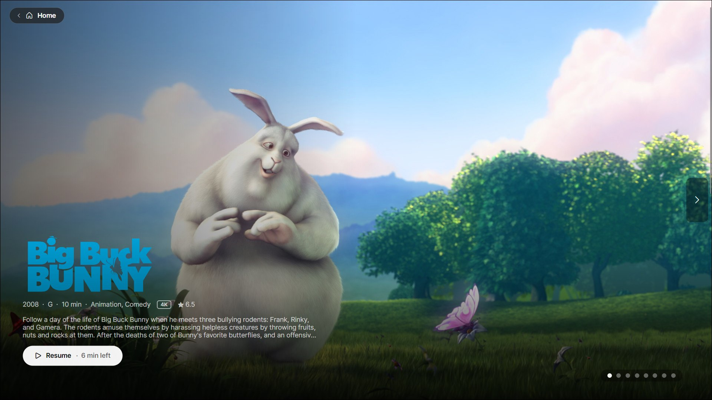
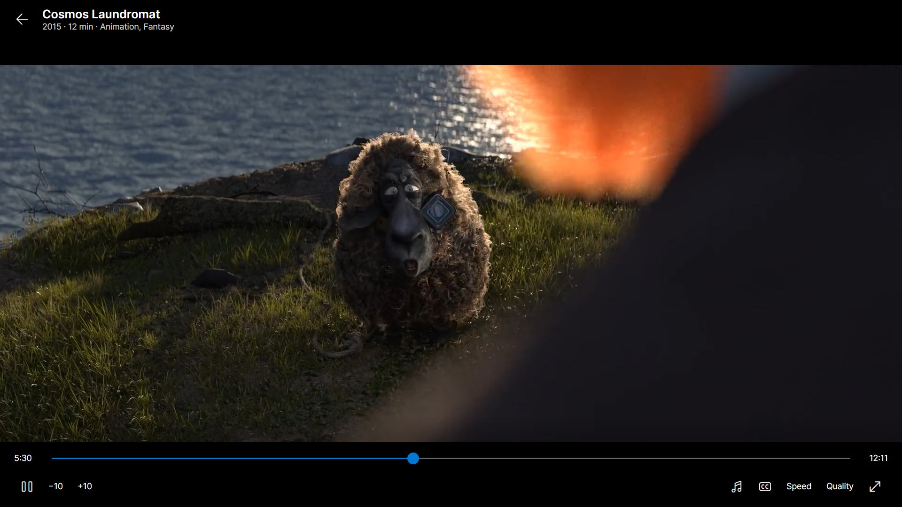
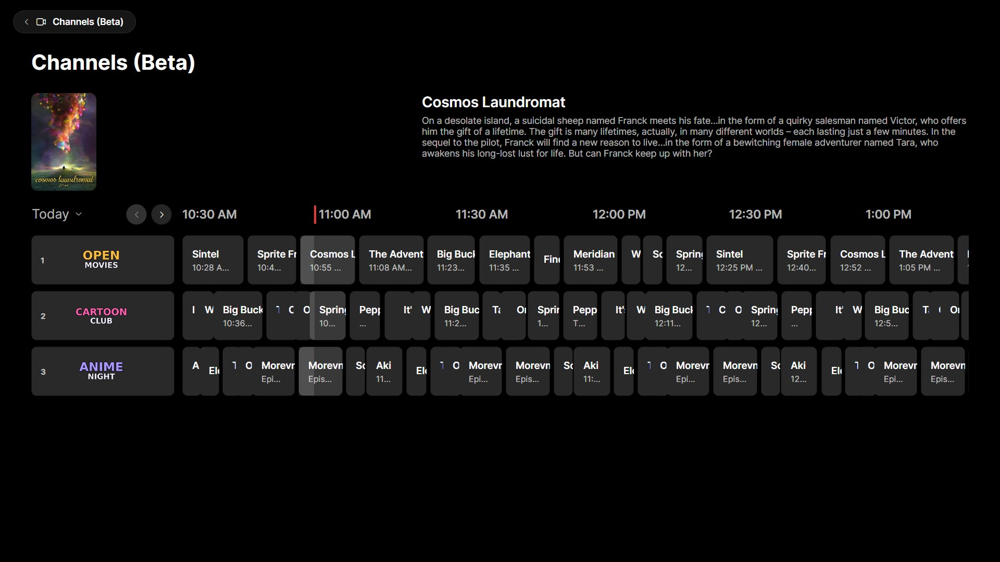
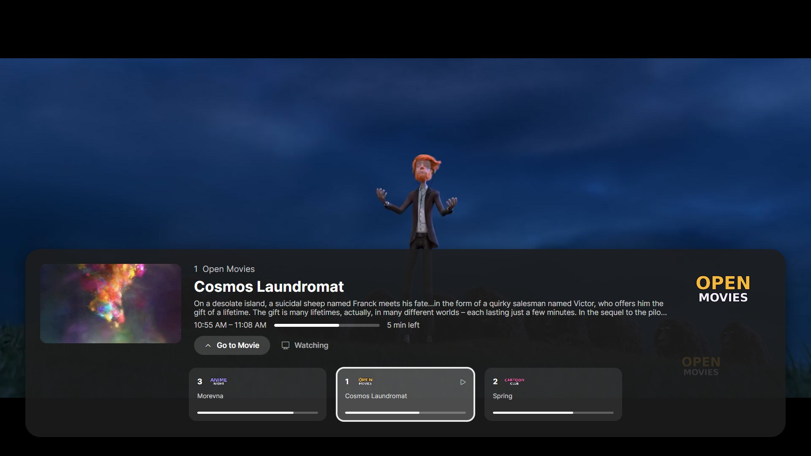
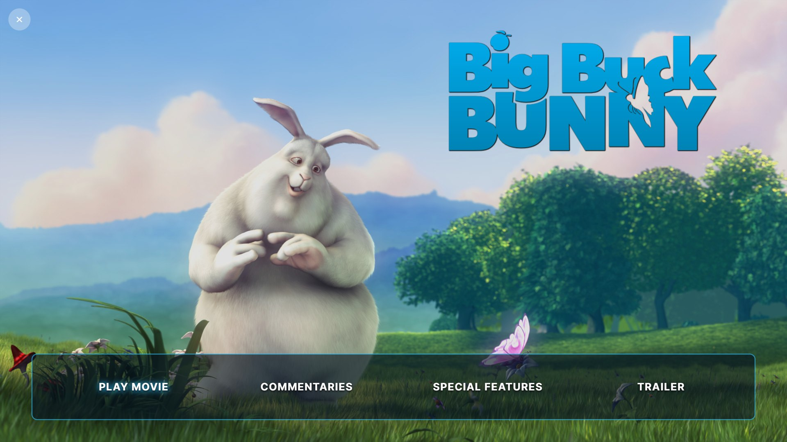
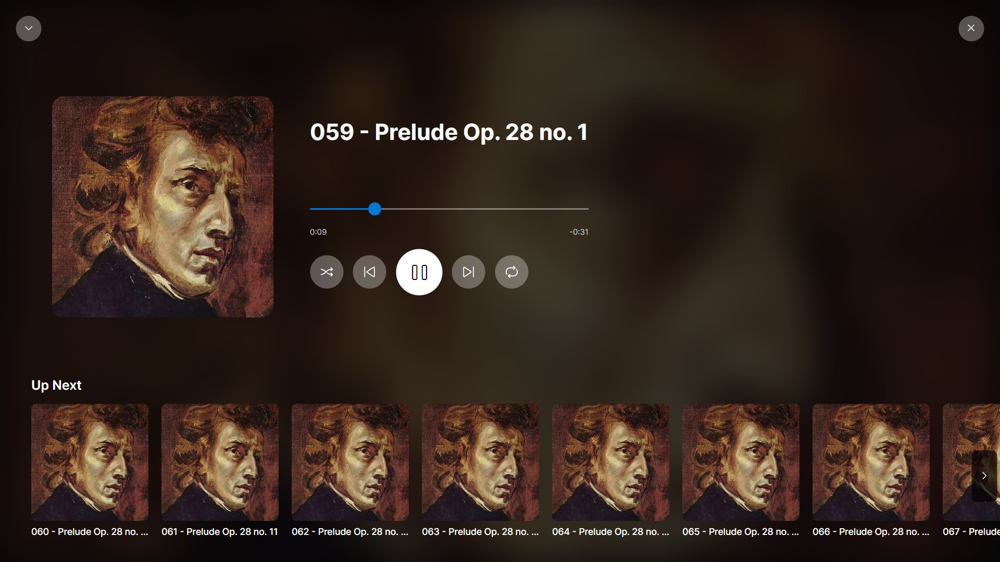

<p align="center">
  
</p>

# Aster for Windows

An Avalonia port of Aster Media Player, for Windows and Linux, in progress.
The Apple app ([Aster-Media-Player](https://github.com/AsterMediaPlayer/Aster-Media-Player)) is the reference:
`Aster.Core` ports its `Jellyfin/` layer file by file, so keep the two in
step when either changes.

## Screenshots

Taken on Windows 11, full screen at 1920×1080, from a demo Jellyfin server
of open-licensed films, shows and music.

| | |
| --- | --- |
|  |  |
| **Home**: featured banner, Continue Watching, Up Next, recently added | **Player**: mpv plays the original file, with every audio and subtitle track |
|  |  |
| **Channels (Beta)**: playlists as TV channels, in one guide | **Channel row**: flick through channels while watching, or Go to Movie |
|  |  |
| **Disc menus**: JellyDisc menus with transitions and sounds | **Music**: Now Playing, with what's up next |

## Download

Get the latest from [Releases](https://github.com/AsterMediaPlayer/aster-windows/releases). Aster is in beta (0.10), following the Apple app.

- **Windows 10 (1809) or later, 64-bit:** `Aster-…-windows-x64-setup.exe`
  installs it for you alone, with no administrator prompt, and adds it to
  the Start menu; the `…-windows-x64.zip` runs from any folder instead. The
  app isn't code-signed yet, so the first time Windows SmartScreen may say
  it protected your PC: choose **More info → Run anyway**.
- **Linux, 64-bit:** unpack `Aster-…-linux-x64.tar.gz` and run
  `./install.sh`, which puts it in `~/.local/opt/aster` with a menu entry
  (`./install.sh --uninstall` removes it). It needs the mpv library:
  `sudo apt install libmpv2` (Fedora: `mpv-libs`, Arch: `mpv`).

Uninstalling or updating keeps your sign-ins and settings.

A release is made by pushing a version tag (`git tag v0.10.0-beta` then
`git push origin v0.10.0-beta`): the Release workflow builds the installer,
the zip and the tarball, self-contained so no .NET is needed, and publishes
them (as a pre-release when the version has a suffix). Run by hand from the
Actions tab, it only builds them, to try.

| Project | What it is |
| --- | --- |
| `src/Aster.Core` | The server interface every screen asks (`Server/IMediaServer`, the Apple app's `MediaServer`, with what each server can do and `ItemQuery` for its titles), Jellyfin client (Jellyfin and Emby), models, device profile, resume points, session storage (Windows Credential Manager), subtitle and trickplay helpers, JellyDisc models, audiobooks (grouping, chapters, speeds), anime openings and endings (found from chapters, and their song cards) |
| `src/Aster.Mpv` | Bindings for libmpv: the player, its events, and OpenGL rendering into the UI |
| `src/Aster.Desktop` | The Avalonia app: sign-in, Home, Movies, TV Shows, Anime, Music, Audiobooks, Library, title, person, album, artist and book pages, the video player, and the music and audiobook players |
| `tests/Aster.Core.Tests` | xUnit tests for the core (against a stub server) and for libmpv (with a clip made by ffmpeg, when it's installed) |

## Build and run

Needs the .NET 10 SDK (`winget install Microsoft.DotNet.SDK.10`). The first
build downloads libmpv (about 120 MB) into `native/` with
`tools/fetch-libmpv.ps1`, pinned to one build and checked against its hash.
Built for Windows, `Aster.Desktop` targets the Windows SDK
(`net10.0-windows10.0.19041.0`, running on Windows 10 1809 and later) for the
system's media controls; built for Linux it targets plain `net10.0`.

```
dotnet run --project src/Aster.Desktop
dotnet test
```

### Linux

The same app runs on Linux (tried on Kubuntu 26.04, Plasma on Wayland,
through XWayland). Build it on Windows or Linux, self-contained so the
machine needs no .NET:

```
dotnet publish src/Aster.Desktop -c Release -r linux-x64 --self-contained -o publish/linux
```

It needs the distribution's mpv library (`sudo apt install libmpv2`), and
OpenGL from a graphics driver for video. What differs from Windows:

- **Signing in** is kept by the desktop's Secret Service (KWallet on KDE,
  GNOME Keyring on GNOME) through libsecret, or, without one, in
  `~/.local/share/Aster/session.json`, readable only by the user.
- **Icons** come from the bundled Aster Icons fonts in place of Segoe
  Fluent Icons, which can't be shipped: Microsoft's Fluent UI System
  Icons (MIT), each at the Segoe code point the app already uses, made by
  `tools/make-icon-font.py`. A new icon needs a line there.
- **Hardware decoding** is VA-API, or with NVIDIA's driver whatever mpv
  finds safe (NVDEC); only then does it try NVIDIA's libraries, so a machine
  without them isn't told it can't load `libcuda`. Where neither works (a
  virtual machine, say), video decodes in software.
- **Game controllers** are read through the SDL3 library the build
  brings along. The desktop gives the person at it the controllers on its
  own; some (PlayStation and Switch ones, through hidraw) also need the
  udev rules Steam installs (`steam-devices`).
- **In a virtual machine**, turn on 3D acceleration: video is drawn with
  OpenGL, and VirtualBox's and VMware's (SVGA3D) works where Avalonia
  would otherwise turn it down. Without 3D, `ASTER_SOFTWARE_GL=1` allows
  Mesa's software renderer, slowly. `ASTER_LOG_AVALONIA=1` prints which
  renderer Avalonia chose, and why.

### Trying it against a server (debug builds)

These leave the saved session alone:

- `ASTER_SERVER`, `ASTER_TOKEN` (an API key or access token) and
  `ASTER_USER_ID` sign in for that run; `ASTER_SERVER_KIND=emby` or `plex`
  for an Emby or Plex server (with a Plex token, and any user id).
- `--plex-sign-in` opens Plex's sign-in straight away.
- `--open <itemId>` opens a title's (or library's, or person's) page.
- `--tab <search|movies|shows|anime|music|audiobooks|upcoming|livetv|channels|library|settings>` starts on a tab; `--sort <Name|DateAdded|ReleaseDate|Rating>` sorts it, and on Live TV `--section <on-now|guide|channels|recordings>` picks its section; with `--open`, `--section <episodes|music|extras|related|details>` picks the title page's tab.
- Signing out of such a session only ends it; the saved sign-in is left alone.
- `--play <itemId>` plays a title straight away, from its resume point;
  `--start <seconds>` and `--max-bitrate <bps>` change where it starts and
  cap its quality (which makes the server convert it). A song or album plays
  in the music player, a book in the book player.
- `ASTER_LOG=<file>` writes the app's and mpv's messages to a file:
  which stream was chosen, the track mapping, the decoder, dropped frames.
- `ASTER_MUTE=1` mutes mpv (video, music and books), for trying playback without the sound.
- For screenshots: `--full-screen` starts full screen; `--disc-menu` (with
  `--open`) opens the title's disc menu; `--channel <number>` (with `--tab
  channels`) tunes in a Channel, and `--flick` shows the channel row once it
  plays; `--now-playing` (with `--play` on music) shows Now Playing.
- `--play-all` (with `--open` on an anime show) presses its Music tab's Play
  All once the cards are in; `--play-all-full` takes the panel full screen.
- `--playlist-picker` (with `--open`) opens that title's Add to Playlist.
- `--paused` (with `--play`) pauses once it starts, for the pause screen.
- `--mini <channelId>` (with `--tab livetv`) tunes that channel straight
  into the Live TV header's mini player.
- `--edit-channels [playlistId]` opens Edit Channels, or one channel's
  settings alone.
- `ASTER_GAMEPAD_SCRIPT="10:down,12:a,14:b"` attaches a pretend game
  controller and presses its buttons that many seconds after starting (a,
  b, x, y, start, lb, rb, up, down, left, right; `hold-down` holds one a
  second and a half), for trying the controller without one.

Playing a title this way reports progress and saves resume points like
any other playback.

## Browsing

Home is the Apple app's: a featured banner as tall as the window (up to 8
titles from Continue Watching, Up Next and the newest movies and shows, its
Play starting the title with its page behind), then Continue Watching, Up
Next, the newest movies, shows and anime, and a shelf per other library.
Anime libraries are told apart as the Apple app does, by sampling titles for
Shoko/AniDB ids.

A title's page has its backdrop, logo, details and actions (Play, Resume
or Play Next, From Beginning, favourite, watched, Go to Series), then for a
show or season tabs of episodes by season, extras, related and details;
for an episode the rest of its season, the next one in view; for a movie
its extras, related titles, cast and information. Right-clicking a card
gives the Apple app's long-press menu. After playing, a page shows where
viewing got to, following on to a later episode that played by itself.

Movies and TV Shows have a banner of what's in progress, up next and new,
Recently Added, then every title as posters, sorted by name (in letter
sections with an index down the right), date added, release date or
rating; anime is left out. The Anime tab has its libraries, Continue
Watching, Next Up, Recently Added and the OP/ED plugin's videos. Library has
every library, favourites and playlists; a library, collection or playlist
opens as a sortable grid, and a cast member as their filmography. A grid
sorted by name loads whole; otherwise 100 at a time as it's scrolled. Each
page is one virtualized list, so a library of thousands scrolls smoothly.

The sidebar collapses as the Apple TV's does: a capsule at the top left
with the tab's icon and name (and, while a song or book plays, its
artwork and play/pause), leaving the page the whole window. Clicking or
resting on the capsule, the pointer at the window's left edge, or Tab into
it slides it out over the page, as a pane of dark glass with the page
dimmed behind: the tabs, Settings and Search at the foot, the one showing
on a soft capsule and the one under the keyboard or pointer on a white
one. Choosing a tab, moving away, clicking the page or Esc puts it away.
A page opened from a tab has its Back arrow there instead.

Back: the page's arrow, the mouse's back button, Alt+← or Backspace.

On a browse page, Up and Down go a row at a time (past headings), onto the
card nearest across from where the keyboard was.

The keyboard (or a remote, which sends the same keys) works as the Apple
TV's remote does. The arrows move between controls in that direction, and
each page starts on its main action: a banner's Play, a title's Play or
Resume, the programme airing now in a guide, the search box. Left and Right
page the banner; in a guide they go from programme to programme, moving
through time past the edge. Left with nothing further left opens the
sidebar on the tab showing, and Right goes back to the page. Enter chooses.
Esc goes back, to the control the page was left on; on a tab's own page it
opens the sidebar. Down (or Enter) from the search box goes to the results.
In the player, Enter (a remote's OK) pauses.

Game controllers work the same way, read through SDL3 (Xbox, PlayStation,
Switch Pro, 8BitDo and most others, plugged in or out while it runs): the
D-pad or left stick are the arrows, repeating while held; A chooses; B goes
back, or opens the sidebar; X or Start plays and pauses; the shoulder
buttons skip songs or a book's chapters, change channel, or jump 30 seconds
in a video. A controller only works the app while its window is in front.
With Steam running, Steam Input can take a controller over for itself;
turn it off for Aster in Steam if the controller does nothing.

Search (or Ctrl+F) looks as typing pauses: movies and shows as a grid,
then shelves of episodes, albums and playlists, artists and songs; a song
plays the songs found, from it.

An anime show's page has a Music tab: its openings, then its endings. They
come from the OP/ED plugin when it has any for the show (the song, who sings
it, which episodes; "Audio only" when there's no video, blurred until a
second click when it's marked as a spoiler or NSFW), else from the episodes'
OP and ED chapters (each new length kept as a new song, with its frame and
the episode it's from). One plays full screen with its song card: a plugin
theme from its own file, a chapter clip as just that stretch of its episode,
the player closing at its end. Neither is reported, so resume points and
watched state stay as they were.

With Theme music or Theme videos on in Settings, a title's page plays its
theme song quietly, or loops its theme video silently behind the page in
place of the still backdrop (Jellyfin's theme media; a season or episode
has its show's). Going from a show to one of its episodes carries on with
the same theme; any other page fades it out. It stays off while a song or
book plays, and quiet while a title plays.

An anime show with no theme video of its own loops an opening behind its
page instead (with Theme videos on): the OP/ED plugin's for the season
picked, else one found in that season's chapters, else the show's first,
never one marked as a spoiler or NSFW. Title Pages' "Opening plays with
sound" gives it its sound, as quiet as theme music.

**Now Playing panel** (`Audio/ThemeDeck`, `Views/ThemeDeckView`): an
opening or ending picked on a show's Music tab plays in a panel at the top
right, then the rest after it like a playlist; **Play All** and **Shuffle**
play them all (skipping any marked as a spoiler or NSFW). It keeps playing
while you browse, with Previous, Play/Pause, Next, Stop and Go to the Show,
and pages leave it room on the right rather than going under it.
**Full screen** grows the same panel to fill the screen, its song card in
the corner (Esc goes back, Space pauses, the arrows skip): mpv's video can't
move between views, so the panel's one view grows rather than handing over.
Title-page themes go quiet while it plays; a title, a disc menu or a song
starting ends it. Settings ▸ Title Pages ▸ Now Playing panel off plays
picks full screen, one at a time, as before.

**Watch OP** and **Watch ED** on an anime show's page play the season
picked's opening and ending full screen, with the song card (the plugin's,
else one found in chapters, else one of the whole show); on an episode's
page, the ones in that episode.

**Versions**: where the OP/ED plugin has them, a song plays in the version
Settings ▸ Title Pages ▸ Version to play prefers: the TV size, the
full-length song (`OP1-Full`) or its music video (`OP1-MV`), else the
nearest it has (a music video falls back to the full version, then the TV
size). A card shows **Full** and **MV** when it has them, and a right click
plays any version (one still being made shows, greyed). Watch OP and the
opening behind the page always use the TV size.

Chinese titles sort under # in the letter index; the Apple app files them
by pinyin, which .NET has no table for.

## Disc menus

A movie, show or season with a JellyDisc menu on the server has a Disc
Menu button on its page; with Settings' "Open disc menu when pressing Play"
on, Play opens it too, like putting in the disc (From Beginning still
plays). It fills the window, full screen as a video would be, on a 16:9
screen letterboxed to fit: the menu's background (a picture, a colour, or a
looping local trailer with its poster until it plays), its panels and
pictures, title and buttons in the frame, text, glow or arrow styles, or
the menu's own artwork. Screens change with their fade, slide, rise, zoom
or wipe; music loops and fades between screens, and the click, chime and
beep sounds are made as the reference renderer makes them (through SDL, so
they're heard at once), or a menu's own sound files. "Menu music and
sounds" in Settings turns them off.

The arrows (a remote's, a controller's) move between buttons by where they
are on screen, Enter chooses, Space or the play key plays what the focused
button plays, and Esc or Back steps back a page, then a screen, then
closes; the mouse points and clicks, with a Back button at the top left.
Scene Selection lists the title's chapters as thumbnails, paged; Play All
plays its extras one after another. A title played from the menu comes
back to the same screen as the player closes.

`Aster.Core/DiscMenu` is a port of the Apple app's rules and navigation,
checked against the JellyDisc conformance vectors (paging, grid cells,
layouts, focus, chapter times, and what to accept from a menu: the tests
load copies from `tests/Aster.Core.Tests/Conformance`). Pictures a menu
names on other sites are fetched without the user's token.

## Upcoming and Live TV

Upcoming shows when shows in the library have episodes airing soon: a
banner of the next to air, with a countdown ("Tomorrow"), then a row for
each day. Most are placeholders from the show's schedule, so a card has the
show's picture and logo, and opens the show; one already on the server is
marked Available and opens itself.

Live TV shows when the server has it, in four sections:

- **On Now:** what's airing, then Movies, Sports, Kids and News, and the
  favourite channels.
- **Guide:** a row per channel (favourites first, then by number), its
  programmes laid out along a timeline from the current half hour to a day
  ahead. Earlier and Later (or Shift and the wheel, or a sideways swipe)
  move through time; Now comes back. Rows load their listings as they
  scroll into view. With the Aster Channels plugin keeping groups, the
  channels go favourites first, then group by group (each in order of its
  lowest number, the ungrouped under Other), with a filter along the top
  (All, Favorites, then each group; Up from the first row reaches it) and
  each group's name on its first channel.
- **Channels:** every channel as a logo; a right-click makes it a
  favourite, or for an administrator, puts it in a group (Group…: none,
  one in use, or a new one), which every device's guide then has.
- **Recordings:** what's been recorded, what's scheduled, and the series
  rules, each rule with its own options page (new episodes only, any
  channel or time, how many to keep and for how long, padding).

A programme's page has Watch (or Watch Channel, later on), Record or Cancel
Recording, Record Series or Series Options, and the channel's favourite. A
channel plays the server's live stream in the player, with LIVE in place of
the timeline; its captions follow the subtitle setting, on only when
subtitles are always on.

**Mini player** (`Audio/LiveMiniPlayer`): closing a channel's full-screen
player while it plays (not paused) keeps the channel going in the Live TV
header, as the Apple app's mini player; clicking it goes full screen again,
and its × (or leaving the Live TV page) ends it, closing the server's live
stream. mpv's picture can't move from one view to another, so the channel
is tuned again in the header, a moment's gap where the Apple app has none.

## Channels (Beta)

Channels are Jellyfin video playlists tagged as channels
([docs/channel-tags.md](https://github.com/AsterMediaPlayer/Aster-Media-Player/blob/main/docs/channel-tags.md)), so the server is the one
place they live and every device finds the same ones. The tab shows when
there are any: the Live TV guide, a week of it with a day picker, each
channel's schedule worked out from the clock rather than fetched. What's on
now tunes in; anything later opens its page.

A channel with anything on it the user's parental controls hold back is
left out, rather than shown with gaps: a playlist that lists more titles
than the server sends the user. Genre, network and collection channels
can't be counted that way, so a restricted user gets one only when its
`rating=` tags keep it within their rating cap and nothing else (blocked
or required tags, unrated titles, closed libraries) is restricted. Users
without restrictions see every channel.

`Aster.Core/Channels` is a port of the Apple app's channel code, kept to it
exactly so a channel shows the same thing at the same moment on a Mac, an
Apple TV and a PC: the tags (read and written as
the Apple app's `AsterFINTests/Conformance/channel-tags.json` says; the
tests load a copy of it from `tests/Aster.Core.Tests/Conformance`),
and the schedule (FNV-1a seeds, SplitMix64 shuffles, times as Swift's `Date`
keeps them, the Gregorian calendar in the local zone), checked against
lineups the Apple app worked out. Rotation, Blocks, Shuffle, In Order and
Air Date; daily, weekly or monthly reshuffles; seeds, weights and lengths;
genres, networks and collections as sources; and breaks of bumpers, promos,
commercials, trailers and interstitials, lined up on the mark or not.

On a channel the player follows the schedule: no timeline or seeking, the
channel's name in place of it, no markers or Up Next, and nothing reported,
so resume points and watched state stay as they were. When a title ends,
what the channel shows now plays.

Up on a channel (Live TV's or Channels') opens the Apple TV's channel row
over the picture: what's on the picked channel, its picture, times and
bug, and the channels either side. Left and right go round them, Enter
changes channel, Up picks Go to Episode (or Movie: what's on, played on
its own from where it was left off), and Down or Esc closes it; it closes
itself after 8 seconds left alone, and everything in it can be clicked.
PageUp and PageDown change channel straight away. The
channel's bug sits in its corner of the picture, steps aside for breaks,
and fades after `bug-hide` seconds.

Channels in groups (`aster:group=Kids`) go group by group, each in order
of its lowest number, the rest under Other, and the guide has the same
filter and group names as Live TV's; flicking runs on from one group into
the next, the row showing the picked channel's group.

**Edit Channels** (`EditChannelsViewModel`), from the Channels tab or
Settings ▸ Channels (Beta), as the Apple app's: an administrator makes a
channel from a show (a public playlist of its episodes), a genre, a network,
a collection or one of their playlists, and opens a channel to set its
name, group, number, what it plays (genres, networks, collections, content,
libraries, years, ratings), mode, logo, corner logo and breaks, with the
rest (episodes in a row, reshuffle, Shuffle Again, lengths, the corner
logo's place and look, filler types, bumpers, commercial time, promos,
trailers, interstitials, line-up and fit, break spacing, users) under
Advanced. Each change writes the playlist's tags at once, keeping its other
tags, and is put back if the server refuses; How Channels Work lists every
tag. Others see that only an administrator can set channels up.

## Settings

Settings has the Apple app's Playback, Audio & Subtitles, Account and
About pages on one page, as the Mac's Settings window has them:

- **On this computer** (`%LOCALAPPDATA%\Aster\settings.json`): the
  maximum streaming quality, and playing videos full screen (on, as on the
  Mac; the window comes back as the player closes).
- **Following the user** between devices and the Apple app: autoplaying
  the next episode, skipping intros, drawing ASS/SSA subtitles styled
  (off, mpv strips them to plain text), theme music and theme videos on
  title pages, the song card at anime openings and endings, and disc
  menus (opening on Play, their music and sounds). They're fetched at sign-in and
  when Settings opens, a change is saved as it's made, and a setting never
  chosen on this computer keeps the default rather than overwriting
  another device's choice.
- **The user's Jellyfin settings**, shared with the web app: the preferred
  audio and subtitle languages and when subtitles show.
- **Account:** the server, its address and Jellyfin or Emby version, and
  every server signed in to, which stay signed in to switch between (also
  from the sign-in screen). Add Server signs in to another, or as someone
  else; Sign Out forgets the one in use. Each server's page switches to it,
  can ask for the user's password first, locks it after time away (5
  minutes to 4 hours, the window in the background, minimized or closed,
  but not while a video plays), checked by the server, and forgets it.
  Loosening the lock (turning off the switch password, or setting Lock
  After to Never or longer) asks for the password or PIN first, so someone
  else at the computer can't. The check signs in as a device of its own and
  straight out again, since Jellyfin ends a device's sign-in when that
  device signs in again.
- **Surround sound** (this computer): sends a video's Dolby and DTS audio
  over HDMI as it is, for the receiver or TV to decode, Dolby Atmos (in
  E-AC-3 or TrueHD) and DTS:X included: mpv's `audio-spdif` for AC-3,
  E-AC-3, DTS, DTS-HD and TrueHD, through WASAPI in exclusive mode on
  Windows (the lossless formats need it), so other apps go quiet while a
  video plays and the receiver sets the volume. Music and audiobooks still
  play as ordinary sound. On Linux the HDMI sink must allow passthrough
  (PipeWire's Passthrough formats in pavucontrol, or `iec958` in ALSA).
- **Channels (Beta)** opens Edit Channels (see Channels).

## The player

mpv plays the file from the server as it is, so every audio and subtitle
track is in hand (ASS with its styling and fonts, PGS, VobSub) and
switches instantly. Over the quality setting, or with a lower quality
chosen, the server converts it to HLS instead, with the chosen text
subtitle loaded beside it and a picture one burned in. A stream that fails
steps down: the server's own choice, then a plain H.264 encode, then an
error. Hardware decoding is on (`d3d11va`).

Skip Intro / Skip Credits come from the server's media segments, Up Next
counts down at the end of an episode, progress goes to the server every 10
seconds, and resume points follow the Apple app's rules.

Chapters, when a title has more than one, are marked under the timeline
and listed in the Chapters menu with their start times, the one playing
ticked; choosing one plays from it. Resting the pointer on the timeline, or
dragging along it, shows the time there and its chapter, and the frame
from the server's trickplay images when it has made them. Sheets of frames
are fetched as they're needed, and only the last few kept in memory. On
Emby, which has no trickplay, the frames come from its BIF file
(`/Videos/{id}/index.bif`, made when the library has thumbnail extraction
turned on), fetched whole on first use and read by `Playback/BifIndex`.
Emby lists a song's lyrics (an `.lrc` beside it, or the file's own tag)
as a subtitle stream instead of a lyrics route, so they're fetched as text
and read as LRC (`SongLyrics.FromLrc`). Both are ported from the Apple
app, but not yet tried against a live Emby server.

An anime episode's opening and ending get the Apple app's song card in the
lower left, for their first 16 seconds and, when they're long enough, their
last: the theme, the song and who sings it, and the show. They're found
from the episode's OP and ED chapters, and show as soon as it plays; with
none, from its skip markers, but only when the OP/ED plugin or AnimeThemes
says one of its themes plays in the episode (so an ordinary show's intro
gets no card). The plugin names the song when it knows it; without the
plugin (on Emby, say), AnimeThemes does, finding the show by its season's
AniDB id (with Shoko) or its name and the year the season began, and each
episode gets the theme made for it (Frieren's first ends with "bliss"
alone). The details are looked up alongside the stream and fill the card in
place as they arrive. A music video gets the card as it starts and ends, and so
does anything a Channel shows. `Aster.Core/Anime` is the port of how they're
found and what the card says.

Keys: Space or K pause, ← → (J L) 10 seconds, ↑ ↓ volume, M mute, A next
audio track, S or C next subtitle track, Page Up and Page Down the next
chapter and back (to the start of this one, or the one before within its
first 3 seconds), Enter takes the skip on offer, F or a double-click full
screen, Esc leaves full screen and then the player.

**Pause screen**, as on the Apple app's Mac and Apple TV: paused, the
title's clear logo (its series' for an episode) takes its name's place, and
above the timeline a panel shows its description, drifting slowly up when
it's long (`Controls/AutoScrollText`), with the year, rating and length and
what the stream is (4K or HD, HDR, CC). On a Live TV channel it shows the
channel's logo and the programme on now with its time left; in a Channels
break, the channel.

Not yet: downloads, and HDR passthrough (HDR is
tone-mapped to SDR, since the video is drawn through OpenGL so the controls
can sit on top of it).

## Music and audiobooks

The Music and Audiobooks tabs show when the server has a music or books
library. Music has Albums (Recently Added, Recently Played, Favorite Albums,
then every album, sortable), Artists, Playlists and Songs. An album or
playlist page lists its tracks by disc, with Play, Shuffle, Instant Mix and
favourite; a playlist's tracks can be moved and removed from their menu. An
artist's page has their albums.

Audiobooks are grouped as the Apple app groups them: a book is a folder of
parts, its author and series taken from the folders above it. The tab has a
banner of books in progress and new, Continue Listening, Recently Added,
then every book, or by author or series. A book's page has its chapters
(from the files' chapter marks, or one per part), Play or Resume and From
the Beginning.

Both play through a second, headless mpv, never at the same time as each
other or a video. While one plays, the sidebar shows it, with play/pause
and stop; clicking it opens the full player: for a song, its artwork,
seeking, shuffle, repeat, synced lyrics when the server has them, and Up
Next; for a book, the chapter's progress and the time left in the book, back
15 and ahead 30 seconds, chapters, and a speed kept per book (in
`%LOCALAPPDATA%\Aster\audiobook-rates.json`). Space or the keyboard's
play/pause key pauses either, its next and previous keys skip songs (or a
book's chapters) and its stop key stops; Esc closes the full player. Progress goes to
the server every 10 seconds, so a book resumes where it was left on any
device.

The system's media controls show the song or book too, and work when the
app isn't in front: on Windows, the media overlay (by the volume flyout, on
the lock screen, and a Bluetooth headset's buttons); on Linux, MPRIS (KDE's
and GNOME's media applets, `playerctl`). They show the song, artist, album
and cover, or the book, author, chapter and cover, with a timeline that can
be dragged (across the whole book). Play, pause, next, previous and stop do
what the keyboard's keys do (next and previous are a book's chapters);
fast-forward and rewind skip a book 30 seconds ahead and 15 back. A video
isn't shown there; the player has its own keys.

**Add to Playlist** (`PlaylistPickerViewModel`): from a card's right-click
menu (a movie, show, season or episode; a show adds all its episodes, a
season its own), a title page's "•••" menu, a song's right-click menu, an
album or playlist page (every song on it), and an anime show's Music tab
(a theme's published music video, or Add All). The picker names a new
playlist or adds to one of the user's of that kind (music or video), then
goes back. Jellyfin and Emby only: Plex's playlists differ.

**Video playlists** (`VideoPlaylistViewModel`) open on a page of their own:
Play All and Shuffle play the entries one after another, each from its
start, and a right click on an entry moves it up or down or takes it out
(shown at once, put back if the server says no). Music playlists keep the
album page.

**Sleep timer** (`Audio/SleepTimer`, not in the Apple app): Now Playing's
clock button pauses the song or book after 15, 30, 45 or 60 minutes, or at
the end of the song or chapter playing, counting down on the button. Its
place is kept as with any pause. Skipping by hand (Next, Previous, a chapter
picked) isn't an end; stopping, or Off, ends the timer.

Not yet: downloads.

## Plex

Plex is ported from the Apple app. Every screen asks the
server through `IMediaServer`, so a Plex server's titles show on the same
pages as Jellyfin's: `Aster.Core/Plex` has Plex's replies (`PlexModels`),
their conversion into the app's titles (`PlexMapper`, times in ticks and
pictures by Plex's own paths through its photo transcoder) and the client.

So far, browsing: Home (Continue Watching, On Deck as Up Next, the newest
films and shows), Movies, TV Shows and Anime (libraries matched by Shoko,
HAMA or AniDB), a library's grid sorted as chosen, a title's page with its
seasons, episodes, related titles and extras, search, and marking watched.
Plex keeps no favourites, so they're hidden; its music, Live TV and the
Jellyfin plugins' pages aren't offered.

Signing in: Sign in with Plex on the sign-in screen shows a code to enter
at plex.tv/link, then who's watching (a Plex Home's profiles, with a PIN
where one is set), then which server (only when the account has more than
one, its own first), then tries every address plex.tv lists for it at once,
home network first, and keeps the first that answers. The sign-in is kept
with its plex.tv side (the server's id, its addresses and the Home profile),
and a Plex server is known by its id, since the address used to reach it
can change. Credential Manager keeps 2,560 bytes an entry, so a longer
secret (a Plex sign-in is) goes in numbered parts. On Plex, Settings leaves
out what Plex keeps itself (the preferred languages) or doesn't have.

Playing (`PlexClient.Playback.cs`): the player asks through `IMediaServer`
as it does Jellyfin. A title plays from its file (Plex's part, with the
token in the address), and mpv reads every track inside it, since Plex
numbers them as the container does. Over the quality limit it plays from
Plex's universal transcoder as HLS, after asking for Plex's decision with
the same settings (Plex refuses a conversion without one); a subtitle file
beside the video is loaded as a file, and any other subtitle is burned in.
The tracks Plex marks selected (its account's language settings, or what
was last chosen) are the defaults. Progress goes to Plex's timeline, which
keeps the resume point and marks a finished title watched. Skips come from
Plex Pass's intro and credits markers, else from chapters named as an
opening or ending (no longer than four minutes: some files call their whole
first half "Intro"). Closing the app waits a moment for the stop report,
which otherwise went unsent (Jellyfin's too). An anime show's Openings &
Endings come from its episodes' chapters, each episode asked for its own
(Plex lists none with a show's episodes), with Plex's chapter pictures; the
opening looping on the page plays from the episode's file, whose id is
remembered from reading it. Not yet on Plex: scrubbing previews (Plex's
preview thumbnails, which a server makes only when set to).

Locking: asking to switch, and Lock After, ask for the Plex Home profile's
PIN, which plex.tv checks by switching to the profile with the Home's own
token (an empty PIN is never sent: plex.tv lets a profile switch to itself
without one). A profile without a PIN, or a sign-in from before the Home's
token was kept, can't be locked; its page offers Sign In with Plex Again.

Finding the server again (`PlexReconnect`): on opening and on coming back
to the window, if the saved address doesn't answer within four seconds,
every other address saved for the server is tried at once, then plex.tv's
latest list, and the first that answers takes over (the app starts afresh
on it).

## Differences from the Apple app

- **Device profile:** playback uses mpv (libmpv), which plays nearly any
  file, so `DeviceProfile.Desktop` direct-plays every container
  and codec and embeds every subtitle format, instead of listing what
  VideoToolbox and AVPlayer decode.
- **Session storage:** Windows Credential Manager, under `Aster/session`,
  in place of the Keychain.
- **Image cache:** a small disk cache in `%LOCALAPPDATA%\Aster\ImageCache`
  in place of URLCache.
- **Settings on the server** use the same display-preferences record as the
  Apple app (`asterfin`), so they follow a user between the two.
